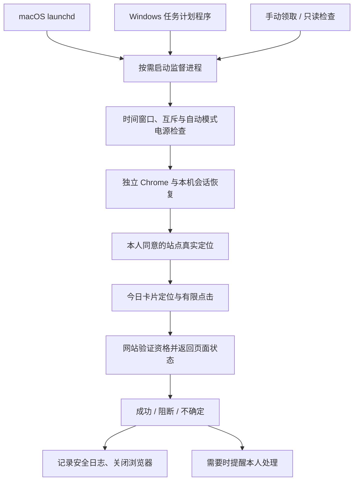

# guanaitong-claim-helper

**关爱通领取辅助工具 · macOS / Windows · 本机运行**

在本人完成登录并明确同意真实定位后，由系统定时任务在每天 **20:30** 后台尝试领取当日权益。也支持 **20:30–24:00** 手动执行和全天只读检查。

> **非官方项目。** 仅用于本人账号、符合平台及公司规则的正常操作。不绕过验证码、位置、网络或领取资格限制，不保证每次成功。
>
> **不要把“自动领取”理解为永久免登录。** 网站会话可能失效；保存 Cookie 不会延长服务器有效期，当前没有可靠的跨天自动续期保证。

[快速开始](#快速开始) · [使用方式](#使用方式) · [技术架构](#技术架构) · [测试与支持状态](#测试与支持状态) · [隐私与安全](#隐私与安全)

## 功能

- **系统调度**：macOS 使用 `launchd`，Windows 使用任务计划程序，不依赖 Agent 或终端常驻。
- **后台执行**：领取使用独立无头 Chrome，不切换日常浏览器标签；人工登录、授权和异常提醒仍需要界面交互。
- **有限尝试**：只定位“今天 20:30”的唯一卡片，最多点击 5 次；成功或遇到阻断即停止。
- **明确结果**：识别已领取文字或已核验的图片印章，不把按钮消失、领取人数、退出码或点击次数当作成功。
- **真实定位**：由本人确认，仅向 `https://c.guanaitong.com` 授权；不设置虚拟坐标。
- **本机隔离**：不使用日常 Chrome 配置，不随源码分享登录态、定位同意或个人日志。
- **可停止**：提供停用定时、撤销定位授权、只读检查等管理入口。

### 运行边界

| 项目 | 当前行为 |
|---|---|
| 自动触发 | 每天本机时区 **20:30，一次** |
| 手动领取 | **20:30（含）至次日 00:00（不含）** |
| 只读检查 | 全天可用；不点击、不主动定位、不弹错误提醒 |
| 睡眠 / 关机 | 不主动唤醒；自动任务不补跑错过的时刻 |
| CPU / 活跃度 | 不判断 CPU 和键鼠活动；锁屏不等于睡眠 |
| 用户会话 | 需本人已登录操作系统；不是注销后仍运行的服务 |
| 单次任务 | worker 最多 120 秒；不是持续运行到午夜 |
| 认证失败 | 提醒人工处理，之后由本人手动重跑 |

## 测试与支持状态

| 平台 | 当前状态 | 不能据此保证的事项 |
|---|---|---|
| macOS | 开发环境验证过登录、真实定位与领取页面结果；有 **51 项测试** | 永久免登录、全部 macOS/硬件组合、未来网站改版 |
| Windows 10/11 | **候选版本，实机待验证**；有 **42 项本地/模拟测试**，任务 XML 通过微软 XSD 校验 | Windows 原生安装、定位、弹窗、睡眠事件与进程回收尚未实测 |

两组测试有共享场景，并不是 93 项独立的 Windows 实机验证。详细说明：[macOS 测试](macos/TESTING.md) · [Windows 验证清单](windows/WINDOWS_VALIDATION.md)。

## 快速开始

需要安装 **Google Chrome** 和 **[uv](https://docs.astral.sh/uv/getting-started/installation/)**。安装器使用独立 Python 3.13 环境，不要求修改系统 Python。首次安装需要联网下载依赖。

请先确认本机时区及已有安装。不要复制其他人的运行目录，也不要覆盖来源不明的同名任务。

### macOS

在仓库根目录执行：

```sh
cd macos
uv venv .venv --python 3.13
uv pip install --python .venv/bin/python -r requirements.txt
.venv/bin/python -m unittest discover -s tests -v
.venv/bin/python install.py --prepare-only
```

接着在 `macos/` 中：

1. 双击生成的 `重新登录.command`，由本人在专用 Chrome 中登录；**不要提前关闭窗口**，脚本识别领取页后会保存并关闭。
2. 双击 `授权真实定位.command`，阅读提示并决定是否同意。
3. 双击 `仅检查.command`。`ready` 只表示识别到按钮，不代表定位和资格已通过。
4. 确认后执行以下命令，启用每日任务：

```sh
.venv/bin/python install.py
```

`--prepare-only` 不改变已有任务的启用状态。若以前已经启用任务，它不会因此被停用。

完整说明：[macOS 使用说明书](macos/USER_GUIDE.md)。

### Windows

进入仓库的 `windows/` 目录，双击 `install.cmd`。它默认仅准备环境，**不会立即领取或启用任务**。

安装完成后依次运行：

1. `重新登录.cmd`
2. `授权真实定位.cmd`
3. `仅检查.cmd`
4. 经本人确认后运行 `启用定时.cmd`，再用 `查看状态.cmd` 核对配置。

Agent 使用非交互命令时，可在 `windows/` 中运行：

```powershell
uv run --no-project --python 3.13 install.py --prepare-only
```

请先完成 [Windows 实机验证清单](windows/WINDOWS_VALIDATION.md)。公司策略拒绝安装或读系统事件时，不要提权绕过或关闭安全保护。

完整说明：[Windows 使用说明](windows/README.md)。

## 使用方式

| 操作 | macOS | Windows |
|---|---|---|
| 人工登录 | `重新登录.command` | `重新登录.cmd` |
| 同意真实定位 | `授权真实定位.command` | `授权真实定位.cmd` |
| 手动实际领取 | `立即领取.command` | `立即领取.cmd` |
| 只读检查 | `仅检查.command` | `仅检查.cmd` |
| 停用定时 | `停用定时.command` | `停用定时.cmd` |

这些管理入口由各平台安装器生成，通常包含接收电脑自己的路径，**不应提交到 Git 或复制给别人**。手动入口可能显示终端；正常定时领取不会通过这些可见终端入口启动。

### 推荐的日常流程

```text
临近领取时间，确认专用浏览器登录有效
                ↓
本人已同意定位，系统定位能力可用
                ↓
20:30 自动运行，或在 20:30–24:00 内手动运行
                ↓
核对日志和网站今日领取状态
```

- 可以每天在接近领取时人工确认登录，但**运行登录指令不等于强制重新认证或自动续期**。
- 早上登录不代表晚上一定有效。会话失效时需本人处理；不承诺长期无人值守。
- 20:30 之后才登录/授权，任务不会自动补领，需要本人再运行一次“立即领取”。
- `ready`、退出码 0、任务存在或点击了 5 次，都不是领取成功证明。应看 `already_claimed`、`verified: true`，并以网站记录为准。

## 技术架构



这是正常领取路径的简图。只读检查不会执行定位/点击；时间和状态也会在执行期间复查。脚本没有自建服务端，不调用私有领取接口，也不替代网站的资格判断。

详细说明：[跨平台架构与权限边界](docs/ARCHITECTURE.md)。

## 常见问题

**登录了，为什么还不能领取？** 还需要真实定位、网络和账号资格满足网站要求。日常 Chrome 与脚本的专用 Chrome 也不是同一份登录资料。

**为什么没有到点执行？** 先区分没触发与触发后停止。检查任务是否启用、电脑是否清醒、用户是否已登录，以及日志的 `mode`、`status`、`phase`、`error`。

**会自动唤醒睡眠电脑吗？** 不会。当前策略就是不唤醒、不补跑；手动运行可在允许窗口内执行。

**为什么按钮消失还不能算成功？** 它也可能表示页面异常。程序只接受已确认的成功文字/印章；网站改版时宁可停止，不把未知状态当作成功。

**如何更新或停用？** 更新源代码后，先运行测试，再由相应平台安装器同步运行副本。删除仓库目录不等于停用任务；请使用平台的停用入口。

## 隐私与安全

运行资料存放在当前用户自己的系统目录：

- macOS：`~/Library/Application Support/GuanaitongAutoClaim/`
- Windows：`%LOCALAPPDATA%\GuanaitongAutoClaim\`

**不要提交或分享：** `chrome-profile/`、`auth-state.json`、`location-consent.json`、`run.log*`、生成的任务配置/快捷入口、真实截图和私人运行报告。会话快照含明文认证材料，文件权限不是加密保护。

定位同意只属于当前设备和用户，不能从发布者或同事那里继承。程序不把坐标、Cookie 或接口正文写入运行日志。

安全说明：[SECURITY.md](SECURITY.md)。请不要在公开 Issue 中贴登录资料、完整任务 XML 或公司内部信息。

## 目录结构

```text
.
├── README.md
├── macos/                # macOS 独立源码、安装器、测试和使用手册
├── windows/              # Windows 独立源码、安装器、测试及实机清单
├── docs/                 # 跨平台架构、发布前检查
├── tools/                # 安全源码打包工具
├── CONTRIBUTING.md
└── SECURITY.md
```

当前保留两套独立安装目录，避免整理仓库时改变已有执行逻辑。请在对应平台目录中运行命令，不要混用安装器或虚拟环境。

## 开发与贡献

- [贡献指南](CONTRIBUTING.md)：测试命令、变更要求及真实操作边界。
- [macOS 测试说明](macos/TESTING.md)
- [Windows 实机验证清单](windows/WINDOWS_VALIDATION.md)
- [发布检查清单](docs/RELEASING.md)

## 许可证与项目状态

**许可证待维护者确认，当前未提供 `LICENSE`。** 在确认代码权属、第三方规则并选择许可证前，不应宣称已经完成开源授权。

本仓库不附带任何人的账号或定位授权；项目名称、源码整理和文档不构成关爱通或所在公司的许可。
