# 技术架构说明

## 1. 总览

这是一个**单用户、本机运行、第三方网页 UI 驱动**的 macOS 自动化工具。没有自建服务端、共享账号中心或常驻队列。`launchd` 负责到点唤起，Python 负责边界检查和执行监督，Playwright 驱动用户已安装的 Chrome，领取资格与最终结果由第三方网站判断。

- [查看独立 SVG 架构图](docs/architecture.svg)
- [编辑 Mermaid 源文件](docs/architecture.mmd)

图中的连接表示调用/数据依赖，不代表所有节点都必然执行。安装、撤销和打包是管理路径，不属于每日领取的主链路。

## 2. 模块职责

| 模块 | 职责 | 重要边界 |
|---|---|---|
| `install.py` | 准备独立环境、复制运行代码、生成 5 个快捷入口、注册/停用 LaunchAgent | 当前 macOS 用户；`--prepare-only` 不更改已有调度状态 |
| `launcher.py` | 启动 worker、等待 JSON 结果、120 秒监督、轮转日志、系统提醒 | 超时只针对本次 worker 的子进程树；不把退出码当成到账证明 |
| `claim.py` | 串联时间检查、锁、浏览器、会话、定位、页面执行 | `--check` 不点击、不授权/主动探测定位；网站登录失败不继续领取 |
| `settings.py` | 本机目录、目标 URL、非阻塞 `flock` | 登录与领取共用锁，避免两个进程同时占用 Chrome 配置 |
| `scheduling.py` | 本机 20:30–24:00 时间窗口；自动模式额外检查启动/唤醒时间 | 状态未知拒绝；手动模式不读电源历史；不主动唤醒电脑 |
| `login.py` | 可见专用 Chrome 人工登录，进入领取页后保存会话 | 不代填凭证、不领取；未识别到领取页不宣称登录保存成功 |
| `browser_state.py` | 保存/恢复 Cookie、localStorage、允许域的 sessionStorage | 敏感材料仅存本机；不能把此文件当作普通配置分享 |
| `location_access.py` | 本人同意、站点范围限制、真实定位探测及撤销 | 默认不授权；仅 `https://c.guanaitong.com`；不设置虚拟坐标 |
| `engine.py` | 识别唯一今日卡片，最多 5 次点击，解析成功/定位/登录/验证状态 | 不按屏幕坐标盲点；未知状态停止；成功需要明确页面证据 |
| 仓库根目录的 `tools/package_source.py` | 按白名单生成双平台源码 ZIP 和 SHA-256 清单 | 不读取运行目录，不打包凭证、同意开关、截图或私人报告 |

技术栈：Python 3.13、Playwright 同步 API、Google Chrome、macOS `launchd` / `osascript` / `sysctl`、POSIX 文件锁。运行依赖版本见 `requirements.txt`。

## 3. 关键执行流程

### 3.1 一次性准备

1. 当前用户运行安装器准备 Application Support 下的代码/虚拟环境，生成管理入口。
2. 本人在可见专用 Chrome 中登录。`login.py` 识别领取页后调用 `save_state`，再关闭浏览器。
3. 本人确认定位同意，`location_access.py` 原子写入本机开关。此操作不会自动启动领取。
4. 只读检查完成后，由用户决定是否注册每日 20:30 的任务；启用后不依赖 Agent 保持打开。

这里有两份独立授权：**网站登录会话**用于账号身份，**本机定位同意**允许该站点获取真实位置。二者都不能替代网站的领取资格校验。

### 3.2 自动/手动领取

1. `launcher.py` 启动 `claim.py` 子进程，保留监督边界。
2. 非检查模式先验证本机 `20:30 ≤ 时间 < 次日 00:00`。自动模式读取 `kern.boottime` / `kern.waketime`；在目标时刻以后开机/唤醒或无法确认状态时拒绝补跑。
3. 获取专用配置锁；失败即返回，不与已有登录/领取进程争用目录。
4. 创建持久 Chrome 上下文、恢复会话。正常领取无头；只有用户显式打开登录入口才使用可见窗口。
5. 仅在本机同意开关有效时，为准确的目标 origin 授予定位权限。打开领取页，识别登录/页面状态。
6. 页面可能领取时，先验证真实定位能否返回有效结果。探测只向 Python 返回状态，不返回坐标；网站仍会通过自身脚本验证位置和资格。
7. `engine.py` 匹配含“今天 20:30”的唯一卡片，寻找可用领取按钮。每轮及实际点击前重查时间/阻断状态，最多 5 次。
8. 发现已领取文字或当前已确认的图片印章，返回 `already_claimed`、`verified: true`。只看人数、余额变化、按钮消失都不够。
9. 异常时先读取当前页面，区分已成功、定位/登录阻断和结果不确定；不会因超时直接认定没收到请求而无限重试。
10. 浏览器在 `finally` 中关闭并释放锁。监督进程记录安全结果，必要时提醒；人工处理后需要用户手动重跑。

### 3.3 只读检查

`launcher.py --check` 仍会启动无头 Chrome、恢复登录会话并读取页面，可能按原逻辑刷新本机会话快照；它**不是完全不写磁盘**。但不会点击领取、主动申请/探测位置或弹出错误提醒，也不受领取时间窗口限制。

## 4. 定时与资源预算

| 约束 | 当前实现 |
|---|---|
| 自动触发 | 每日本机时间 20:30，一次；`KeepAlive=false`、`RunAtLoad=false` |
| 允许领取窗口 | 20:30（含）至次日 00:00（不含）；不表示窗口内循环运行 |
| 自动补跑 | 睡眠/关机错过后拒绝；不主动唤醒 |
| CPU / 空闲判断 | 不使用；锁屏但未睡眠不构成跳过条件 |
| worker 上限 | 监督进程等待 120 秒，超时触发本次进程树清理 |
| 普通点击 | 最多 5 次，间隔约 2 秒；阻断或成功提前停止 |
| 定时尚未开始 | 最多约 20 秒的有限刷新等待，不无限等待开放 |
| 真实定位探测 | 原生 15 秒超时，另设约 1 秒的 JS 收尾保护 |
| 信息弹窗 | 60 秒自动关闭，外部进程最多等 65 秒 |
| 人工登录 | 约 15 分钟等待；导航等阶段另有各自超时 |

文件锁只提供本机互斥，页面状态只提供 UI 级防重复；本工具不保证服务器级 exactly-once，也不替代第三方服务的幂等控制。

## 5. 信任边界与权限

| 资源/操作 | 谁授权或决定 | 允许行为 | 拒绝/风险边界 |
|---|---|---|---|
| 网站账号 | 用户本人登录，服务端验证 | 当前用户独立浏览器会话访问网站 | 过期时停止，不自动获取密码或绕过验证码 |
| 本机定位 | 当前用户明确同意；系统/浏览器提供能力 | 只为指定 origin 授予真实定位 | 无同意、来源不符、定位失败时不领取；不注入坐标 |
| 领取资格 | 第三方网站及公司规则 | 通过网页正常交互提交 | 不直接调用私有领取接口，不跳过地理/网络/资格限制 |
| 自动任务 | 当前 macOS 用户启用 LaunchAgent | 对该用户的运行副本执行一次 | 不注册系统级 daemon，不使用 root，不唤醒机器 |
| 本地资料 | 当前 OS 用户的文件权限 | 脚本按需读写私有运行目录 | 不能隔离同一 OS 用户下的其他恶意进程；不是加密保险箱 |
| 对外分享 | 仓库维护者审核白名单 | 仅源码、测试和公开文档/图表 | 不分享浏览器配置、会话、同意开关、日志、真实截图或私人报告 |

主要跨边界链路：用户 → 本机授权文件；Python → 浏览器；浏览器 → 登录/领取网站；浏览器 → 真实定位服务。日志只保存状态，不保存这些请求的 Cookie、正文或位置。没有自建数据库、角色系统或行级权限；不能把共享源码理解为共享账号授权。

## 6. 本地数据与配置

基目录由 `settings.ROOT = Path.home() / "Library/Application Support/GuanaitongAutoClaim"` 计算，不硬编码发布者用户名。

| 名称 | 读写者 / 来源 | 内容与风险 | 更新或撤销方式 |
|---|---|---|---|
| `code/`、`.venv/` | `install.py` | 当前用户的运行副本和独立依赖 | 测试后重新安装；改源码不自动改变运行副本 |
| `chrome-profile/` | Chrome 持久上下文 | 浏览器资料，可能包含网站缓存与会话数据 | 不分享；完整删除前先停用并确认影响 |
| `auth-state.json` | `browser_state.py` | **含敏感会话材料的明文 JSON**；权限 600，不应进 Git | 人工重新登录刷新；疑似泄露需在平台撤销会话 |
| `location-consent.json` | `location_access.py` | origin、同意开关、更新时间；不含坐标，权限 600 | 本人授权 / `--revoke`；不会随包迁移 |
| `profile.lock` | `settings.profile_lock` | `flock` 的锁文件，不是持久“运行中”标志 | 操作系统释放锁；不要以删除文件代替正常结束 |
| `run.log` 及备份 | `launcher.py` | 时间、模式、状态、尝试数、成功标记、固定诊断类别 | 256 KiB 轮转，最多 3 个备份；不上传原始个人运行日志 |
| `TARGET_URL` / `ORIGIN` | `settings.py` / `location_access.py` | 目标网页与精确的定位权限 origin，不是用户可随意填入的通用浏览器服务 | 更换站点需重新设计/测试，不能仅改 URL 后宣称可用 |
| 时间及资源参数 | `scheduling.py`、`launcher.py`、`engine.py`、`install.py` | 窗口、超时、点击预算、每日触发时间 | 当前为代码常量；修改后测试并同步运行副本 |
| LaunchAgent plist | `install.py` | 位于 `~/Library/LaunchAgents/`，包含接收用户自己的绝对路径 | 安装器生成；停用时仅移除本工具配置 |

没有 API Key 或密码需要提交到源码。源码包不内置账户凭证；浏览器运行时持有会话是正常且敏感的，不能因此宣称客户端“完全没有秘密”。

## 7. 输出与失败语义

worker 输出 `status`、`clicks`、`verified`，以及可选的 `phase`、`error`。监督进程只接收固定字段及受限的诊断类别，补充 `mode` 与本机完成时间后写日志。

- `already_claimed` + `verified=true` 表示观察到了明确的今日已领取 UI；不是金融记账 API 的强一致回执。
- `ready` 是按钮可用，不是资格验证结果；`attempts_complete` 是点击预算耗尽，不是成功。
- `click_result_uncertain` 表示不能确定操作结果，需先核对网站。异常详情不是未经处理地写入日志。
- 退出码：登录需求通常为 2，部分执行/定位失败为 1；其他可预期状态也可能为 0，**不能只看退出码认定到账**。
- 登录/定位问题会显示系统提醒；其余结构/验证问题主要记录状态，不保证每一种失败都弹窗。

## 8. 已知风险与设计取舍

| 风险 / 假设 | 实现依据与取舍 |
|---|---|
| 网站改版 | `engine.py` 依赖今日卡片、按钮类名和已核验印章资源路径；未知资源保守停下，维护时需重新确认 UI 含义 |
| 定位服务变化 | `location_access.py` 使用原生浏览器定位，成功受系统权限、硬件、网络和服务提供方影响；不做位置伪造兜底 |
| 会话失效 | `browser_state.py` 可恢复本地快照，但无法延长服务端有效期；用户需要重新登录 |
| 时间与睡眠 | `scheduling.py` 依赖本机时区和 macOS 内核时间；不等同于证明人在工作或位于公司 |
| 迟到反馈 | 一次点击后可能仍有异步网页行为；脚本限制时间并在异常后复核，不保证第三方状态即时一致 |
| 进程/提醒可靠性 | 超时清理及原生弹窗依赖操作系统；锁屏时提醒可能不可见，资源异常下清理仍需人工核验 |
| 敏感资料保护 | 目录/文件权限降低意外暴露风险，但 JSON 不是加密存储；建议由用户管理磁盘加密与设备安全 |
| 维护与发布 | 运行副本不会自动升级；源码授权和第三方政策需维护者确认，许可证未选择前不能宣称已完成开源授权 |

无邮件、Webhook、自建云服务、公开索引页面或嵌入式 AI Agent；不为这些不存在的能力创建虚构链路。浏览器自动化的唯一业务目标是本人的网页领取流程。

## 9. 相关文档

沿用项目根目录 Markdown 布局，把权限、数据与执行流程合并在本文件，避免重复维护多份相互矛盾的说明。

- [使用说明书](USER_GUIDE.md)：从安装到故障排查。
- [测试与验证边界](TESTING.md)：现有覆盖、建议补充和未验证事项。
- [开源前检查清单](../docs/RELEASING.md)：许可证、隐私及发布边界。
- [Agent 交接说明](AGENT_HANDOFF.md)：由本人授权的接收电脑安装步骤。
- [Mermaid 源图](docs/architecture.mmd)：可编辑的架构图定义。
